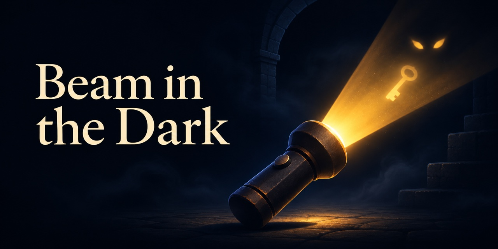
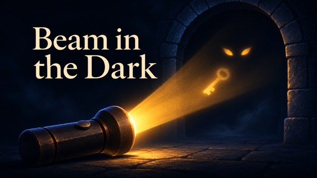

<p align="center">
  <a href="https://int28t.github.io/beam-in-the-dark/">
    
  </a>
</p>

<h2 align="center">Один фонарь. Один ключ.<br>Сколько этажей ты переживёшь?</h2>

<p align="center">
  Атмосферный стелс-хоррор о свете, который нельзя тратить зря.<br>
  Играй в браузере или открой замок прямо в Telegram.
</p>

<p align="center">
  
  <a href="https://t.me/BeamInTheDarkBot"></a>
  <a href="./LICENSE"></a>
</p>

<p align="center">
  <a href="https://int28t.github.io/beam-in-the-dark/"><strong>▶ Играть в браузере</strong></a>
  &nbsp; · &nbsp;
  <a href="https://t.me/BeamInTheDarkBot"><strong>Открыть в Telegram</strong></a>
</p>

---

## В этом замке темнота не бывает пустой

Где-то за стенами ходят тени. У тебя есть фонарь, немного заряда и дверь, к которой ещё нужно найти ключ.

Исследуй комнаты, прячься за стенами и сдерживай преследователя лучом света. Найденный выход — начало следующего этажа. А вместе с ним — нового риска.

| Свет | Укрытие | Выход |
| :--- | :--- | :--- |
| Направь луч на тень, чтобы выиграть время. Заряд уходит быстрее. | Скройся за стеной и уйди с последней позиции, где тебя видели. | Найди золотой ключ и доберись до бирюзовой двери. |

## Каждый забег — ещё одна попытка зайти дальше

- **Меняющийся замок.** Этажи собираются из комнат и коридоров заново; ключ и выход ждут в разных частях карты.
- **Охота в темноте.** Тени патрулируют, замечают движение вблизи и ищут тебя после потери следа.
- **Заряд на исходе.** Ищи батарейки и береги свет для встречи, от которой не получится просто отвернуться.
- **Личный рекорд.** Сколько этажей подряд ты пройдёшь без поражения? Повтор начинает новую серию на том же этаже.
- **На компьютере и телефоне.** Клавиатура и мышь или сенсорные стики. Для независимого света на телефоне включи правый джойстик в настройках.

## Войти легко. Выйти — уже твоя задача

| Действие | Компьютер | Телефон |
| :--- | :--- | :--- |
| Двигаться | WASD / стрелки | Левый джойстик |
| Направить свет | Мышь | По движению или правым джойстиком |
| Переключить фонарь | F | Кнопка «Фонарь» |
| Пауза | Esc | Кнопка вверху |

Подойди к ключу или батарейке, чтобы подобрать их. Выход откроется с ключом. Когда заряд закончится, останется слабый ореол — шанс найти батарейку и снова включить луч.

<p align="center">
  <a href="https://t.me/BeamInTheDarkBot">
    
  </a>
  <br><br>
  <a href="https://t.me/BeamInTheDarkBot"><strong>Открыть @BeamInTheDarkBot →</strong></a>
</p>

---

<details>
<summary><strong>Запуск и разработка</strong></summary>

Игра работает как статический сайт без сборки и npm.

```sh
python3 -m http.server 8000 --bind 127.0.0.1
```

Открой [localhost:8000](http://localhost:8000). Нужны современный браузер с WebGL 2 и доступ к интернету для CDN-зависимостей. Запуск через `file://` не поддерживается.

Проверки игровой логики доступны на [странице тестов](https://int28t.github.io/beam-in-the-dark/tests/index.html) либо в терминале с Node.js 22.18+:

```sh
node tests/run.js
```

**Технологии:** JavaScript, [Three.js 0.187.0](https://github.com/mrdoob/three.js/tree/r187), [NippleJS 1.0.4](https://www.npmjs.com/package/nipplejs/v/1.0.4), Web Audio API и [Telegram Mini Apps](https://core.telegram.org/bots/webapps). Игровые модели и звуки создаются программно; иллюстрации в README — промо-арт.

Рекорд и настройки хранятся локально. Облачного переноса рекорда между браузером и Telegram нет. Каждый новый этаж начинает со свежим зарядом; повтор сохраняет раскладку, сбрасывает предметы и позицию. Код этажа виден в паузе.

**Статус:** 0.9.0, ранний доступ. Логика покрыта автоматическими проверками; баланс, визуальная читаемость и производительность на реальных устройствах ещё требуют игровых тестов.

</details>

<p align="center">
  <sub>Beam in the Dark · <a href="./LICENSE">MIT License</a></sub>
</p>
